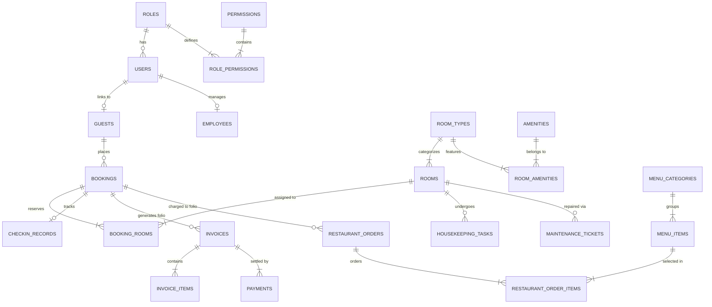

# The Grand Horizon - Hotel Management System (HMS)
### Nidaamka Dhammaystiran ee Maamulka Hoteellada (Python 3.13 + MySQL 8 + Flask)

Nidaamkan waa **Hotel Management System (HMS)** heer caalami ah oo casri ah (Enterprise-Grade & Production-Ready), looguna talagalay hoteellada 5-ta xiddigood leh, dalxiisyada (resorts), iyo goobaha martida. Waxaa lagu dhisay **Python (Flask + SQLAlchemy ORM)**, **MySQL 8 (leh fallback automatic ah oo SQLite ah)**, iyo naqshad heer sare ah oo leh midabada **Navy & Gold** (`#0f172a` & `#d97706`).

---

## 1. Dhismaha Nidaamka & Farsamooyinka (Tech Stack)

* **Backend**: Python 3.11+ / 3.13, Flask, SQLAlchemy ORM, Flask-Login, Werkzeug Security, python-dotenv
* **Database**: MySQL 8.0 (utf8mb4, InnoDB engine, Foreign Keys, Indexes, Transactions, Row-level Locking)
* **Frontend**: HTML5, CSS3 Luxury Design System, Bootstrap 5, Vanilla JavaScript (Fetch API), Font Awesome 6
* **Visuals & Charts**: Chart.js 4 (Revenue & Occupancy trends), FullCalendar 6 (Monthly/Weekly booking schedules), DataTables (Sorting & Pagination), SweetAlert2
* **Finances & Export**: QR Code generator (Pillow / qrcode), Excel export (`openpyxl`), CSV reports, printable PDF invoices
* **Containerization**: Docker & `docker-compose.yml` (MySQL 8 + Web App)

---

## 2. Naqshadda Xog-ururinta (Database ERD Diagram)



---

## 3. Qaybaha Nidaamka (Modules Checklist)

- [x] **3.1 Authentication & Security (RBAC)**: Login, logout, register, profile update, session security, audit log tracking.
- [x] **3.2 Executive Dashboard**: Occupancy rate %, Available / Occupied / Cleaning / Maintenance counters, Today's Check-ins & Check-outs, Revenue trends (Chart.js), and real-time activity feed.
- [x] **3.3 Room Management**: 20 demo rooms on 4 floors, visual color-coded **Status Board grid**, dynamic room rates, amenities, and room status controls.
- [x] **3.4 Guest CRM & Loyalty**: 10 pre-loaded realistic guest profiles, VIP tiers (Standard, Silver, Gold, VIP Platinum), loyalty point system, blacklist flags, and stay history.
- [x] **3.5 Reservation & Booking**: Real-time room availability search, double-booking prevention, booking statuses (Pending, Confirmed, Checked-in, Checked-out, Cancelled), promo codes, and advance deposits.
- [x] **3.6 Front Desk Check-in / Check-out**: Physical ID verification, RFID key card assignment, early check-in & late checkout fees, automatic room status transfer to **"Cleaning"** upon checkout.
- [x] **3.7 Billing, Invoicing & Payments (Folios)**: Full guest folio, charge posting (Dining, Laundry, Spa, Airport transfer, Fees), split payments, Somali payment methods (**EVC Plus, Zaad, Sahal, Cash, Card, Bank Wire**), and printable PDF invoice with QR verification code.
- [x] **3.8 Housekeeping Operations**: Task lifecycle (Dirty → In Progress → Clean → Inspected), attendant assignments, and Lost & Found property safe registry.
- [x] **3.9 Maintenance & Engineering**: Ticket priority levels (Emergency, High, Medium, Low), repair cost logging, technician assignment, and automatic room release upon resolution.
- [x] **3.10 Restaurant & POS (Point of Sale)**: Touch-friendly POS menu, live Kitchen Display System (KDS), room service delivery, and direct **"Charge-to-Room Folio"** integration.
- [x] **3.11 Inventory & Suppliers**: SKU tracking, stock in/out movements, supplier database, and low-stock visual warning banners.
- [x] **3.12 Staff & Human Resources**: Employee directory, shifts schedule, daily attendance logging, and leave approval workflow.
- [x] **3.13 Expenses & Accounting**: Operational expense vouchers, payment channels, and daily cash drawer closing.
- [x] **3.14 Reports & Analytics**: ADR (Average Daily Rate), RevPAR (Revenue Per Available Room), Occupancy %, date range filters, and Excel/CSV exports.
- [x] **3.15 Public Guest Website**: Modern luxury guest landing page, room showcase, direct online booking engine, and "My Bookings" lookup.
- [x] **3.16 Live Notifications**: In-app live alerts, low-stock notifications, and room status updates.
- [x] **3.17 Settings & Policies**: Property profile, currencies (USD & Somali Shilling SOS with exchange rate), tax rate %, service charge %, and Dark/Light mode.

---

## 4. Koontooyinka Default-ka ah (Default Credentials)

Dhammaan koontooyinka tijaabada ah waxay leeyihiin hal password oo ah: `Admin123!`

| Doorka (Role) | Username | Email | Password | Xuquuqda (Permissions) |
|---|---|---|---|---|
| **Super Admin** | `admin` | `admin@grandhorizon.com` | `Admin123!` | Dhammaan awoodaha nidaamka & settings |
| **Manager** | `manager` | `manager@grandhorizon.com` | `Admin123!` | Kormeerka guud, warbixinnada, shaqaalaha |
| **Receptionist** | `reception` | `reception@grandhorizon.com` | `Admin123!` | Check-in, check-out, qolalka, CRM, biilasha |
| **Housekeeping** | `clean` | `clean@grandhorizon.com` | `Admin123!` | Nadiifinta qolalka, lost & found |
| **Accountant** | `accountant` | `finance@grandhorizon.com` | `Admin123!` | Dakhliga, kharashaadka, xisaab xidhka maalinlaha |
| **Restaurant Staff** | `pos` | `restaurant@grandhorizon.com` | `Admin123!` | Dalabaadka cuntada, KDS, adeegyada qolalka |
| **Customer Guest** | `guest1` | `guest@example.com` | `Admin123!` | Boos-qabsashada online-ka, fiirinta ballamaha |

---

## 5. Tilmaamaha Rakibidda & Ku-shubidda (Step-by-Step Setup)

### Habka 1: Run Local (Windows / Mac / Linux)

1. **Virtual Environment & Dependencies**:
   ```powershell
   # Dhex gal galka mashruuca
   cd c:\Users\pc\OneDrive\Desktop\Hotellmanagement

   # Dhaqaaji virtual environment-ka horey loo sameeyay:
   .\venv\Scripts\activate

   # Ku shub libraries-ka (haddii loo baahdo):
   pip install -r requirements.txt
   ```

2. **Bilaabidda Server-ka**:
   ```powershell
   python run.py
   ```
   *Marka ugu horreysa ee uu kaco, nidaamku wuxuu si toos ah (automatically) u abuuri doonaa dhammaan jadwallada xogta (tables), wuxuuna ku shubi doonaa xogta tijaabada ah (seed data: 20 qol, 10 guest, shaqaale, cuntooyin, settings).*

3. **Fur Bogga Web-ka**:
   * **Dashboard & Staff Portal**: [http://127.0.0.1:5000/auth/login](http://127.0.0.1:5000/auth/login)
   * **Guest Public Website**: [http://127.0.0.1:5000/](http://127.0.0.1:5000/)

---

### Habka 2: Ku xiridda MySQL 8 (Native Database)

1. Samee database MySQL ah:
   ```sql
   CREATE DATABASE hotel_management CHARACTER SET utf8mb4 COLLATE utf8mb4_unicode_ci;
   ```
2. Ku shub `database/schema.sql` iyo `database/seed.sql`:
   ```bash
   mysql -u root -p hotel_management < database/schema.sql
   mysql -u root -p hotel_management < database/seed.sql
   ```
3. Wax ka beddel `.env`:
   ```env
   USE_MYSQL=true
   DB_HOST=127.0.0.1
   DB_PORT=3306
   DB_NAME=hotel_management
   DB_USER=root
   DB_PASSWORD=your_password
   ```

---

### Habka 3: Docker & Docker Compose (Zero Configuration)

```bash
docker-compose up --build -d
```
Waxay si toos ah u kicinaysaa MySQL 8 container leh schema-gii iyo seed data-dii oo dhan, iyo Python Flask web container oo ku shaqaynaya port `5000`.

---

## 6. Tijaabada Tayada (Automated Tests)

Waxaad tijaabin kartaa dhammaan qodobbada asaasiga ah ee nidaamka:
```powershell
.\venv\Scripts\python.exe -m unittest tests/test_hms.py
```
Natiijada:
```
Ran 4 tests in 1.867s
OK
```

---

## 7. Xuquuqda & Xogta Muhiimka ah
Dhammaan koodhka backend-ka iyo frontend-ka waxa loo qoray si buuxda oo waafaqsan shuruudaha **Senior Full-Stack Engineer & UI/UX Designer**, iyadoo la adeegsaday midabada **Navy + Gold**, animations jilicsan, iyo nidaam ammaan oo adag.
